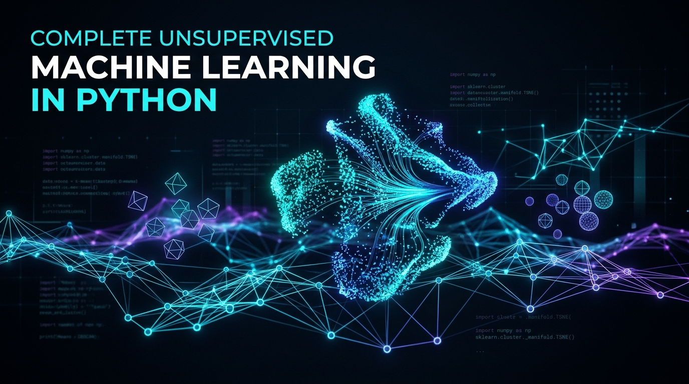

<div align="center">



# Complete Unsupervised Machine Learning in Python
### *Discovering Structure, Representations, and Anomalies in Unlabelled Real-World Data*

[](https://www.python.org/)
[](https://pytorch.org/)
[](https://keras.io/)
[](https://scikit-learn.org/)
[](https://ollama.ai/)
[](https://opensource.org/licenses/MIT)
[](https://github.com/udityamerit/Complete-Unsupervised-Machine-Learning)
[](https://github.com/udityamerit/Complete-Unsupervised-Machine-Learning/pulls)

<p align="center">
  <b>A production-grade open-source handbook, architecture blueprint, and benchmark suite for mastering unsupervised machine learning on unlabelled signals, transactions, high-dimensional spaces, recommender sequences, and raw text.</b>
</p>

[Explore Modules](#-core-modules) •
[Architecture Pipeline](#-architecture--pipeline-flow) •
[Benchmark Matrix](#-empirical-benchmarks--case-studies) •
[Quickstart](#-quickstart--installation) •
[Tech Stack](#-tech-stack--ecosystem) •
[Contributing](#-contributing)

---

</div>

## 📌 Executive Overview

In real-world data science, **over 90% of raw enterprise data arrives without ground truth labels**. There is no pre-existing answer key indicating which customers belong to distinct personas, which financial transactions constitute sophisticated fraud, which cardiac arrhythmias share morphological anomalies, which item a consumer will interact with next, or what intent underlies millions of unstructured customer messages.

**Unsupervised Machine Learning** is the discipline of extracting intrinsic geometry and functional representations from unlabelled data:
1. **Compressing** high-dimensional feature spaces while preserving essential topological manifolds.
2. **Partitioning** complex distributions into coherent clusters.
3. **Scoring and ranking** rare outliers and anomalous events.
4. **Learning self-supervised representations** that empower downstream semi-supervised pipelines.
5. **Synthesizing semantics** using modern vector embeddings and local LLMs without relying on proprietary external APIs.

This repository provides end-to-end, runnable Jupyter notebooks, clean modular implementations, and honest empirical analyses across real-world datasets—from the **284k credit card fraud dataset** to **MovieLens 1M recommendation engines**, **10,000 ECG heartbeat records**, and **local Ollama-driven text topic synthesis**.

---

## 🏗️ Architecture & Pipeline Flow

The diagram below illustrates how raw, unlabelled multi-modal data traverses the unsupervised machine learning lifecycle implemented throughout this repository:

```mermaid
flowchart TB
    subgraph Ingestion["1. Multi-Modal Unlabelled Ingestion"]
        D1["Tabular & Financial Data<br/>(284k Credit Card Records)"]
        D2["High-Dimensional Vision<br/>(MNIST Digits 784-D)"]
        D3["Continuous Signals & Waveforms<br/>(ECG Heartbeat Signals)"]
        D4["Implicit User Interactions<br/>(MovieLens 1M Ratings)"]
        D5["Unstructured Customer Text<br/>(10k Banking Messages)"]
    end

    subgraph Manifolds["2. Representation & Manifold Learning"]
        M1["Linear & Kernel Projections<br/>(PCA, Sparse PCA, Kernel PCA, SVD)"]
        M2["Nonlinear Manifold Projections<br/>(t-SNE, UMAP, Isomap, LLE)"]
        M3["Deep Neural Embeddings<br/>(Keras 3 Autoencoders, Sentence-Transformers)"]
    end

    subgraph Engines["3. Core Unsupervised Engines"]
        E1["Anomaly & Outlier Scoring<br/>(iForest, ECOD, LOF, Reconstruction Error)"]
        E2["Cluster Analysis & Density Partitioning<br/>(k-means, GMM, DBSCAN, HDBSCAN)"]
        E3["Dynamic Signal Matching<br/>(Dynamic Time Warping, k-Shape)"]
        E4["Collaborative & Sequential RecSys<br/>(Implicit ALS, EASE, SASRec Transformers)"]
        E5["Topic Discovery & LLM Synthesis<br/>(BERTopic + Ollama Qwen 4B)"]
    end

    subgraph Evaluation["4. Rigorous Label-Free Evaluation"]
        V1["Cluster Quality: Silhouette, Elbow, ARI, Purity"]
        V2["Fraud Metrics: Average Precision (PR-AUC), Daily Review Budget"]
        V3["RecSys Ranking: Recall@10, NDCG@10 (Time-Split)"]
    end

    subgraph Delivery["5. Downstream Applications"]
        APP1["Automated Fraud Triaging"]
        APP2["Customer Segmentation Personas"]
        APP3["Next-Action Recommendations"]
        APP4["Zero-Shot Support Ticket Auto-Tagging"]
    end

    Ingestion --> Manifolds
    Manifolds --> Engines
    Engines --> Evaluation
    Evaluation --> Delivery
```



---

## 🎯 What Sets This Repository Apart

### 1. Honest Empirical Results & "Why Algorithms Fail"
Unlike simplified tutorials where every algorithm magically succeeds, this repository documents real-world engineering realities:
- **Feature Scaling Pitfalls:** Discover why standardizing features destroys PCA reconstruction signals in fraud detection.
- **Density Traps:** Understand why Local Outlier Factor (LOF) fails when fraudulent transactions form tight micro-clusters.
- **Waveform Shifts:** Learn why standard Euclidean distance fails completely on time-shifted ECG heartbeats, and how Dynamic Time Warping (DTW) and shape-based distance resolve it.
- **Autoencoder Stochasticity:** Observe how wide, unregularized autoencoders yield volatile anomaly scores across seeds, and how bottleneck architectures stabilize them.
- **Clustering Bias:** See why UMAP + HDBSCAN can score lower than $k$-means when $k$ is artificially known, revealing what popular metrics conceal.

### 2. Modern 2026 Tooling & Zero-Cost Privacy
- **UV Package Management:** Lightning-fast, deterministic virtual environment management with `uv`.
- **Keras 3 on PyTorch:** Future-proof deep learning architectures utilizing the flexible PyTorch backend.
- **Local LLM Synthesis:** Cluster naming and semantic extraction running 100% locally with **Ollama** and **Qwen** models—no external cloud API keys, recurring subscriptions, or privacy leaks.
- **Self-Contained Datasets:** Every dataset downloads programmatically inside the notebooks without mandatory logins or external manual setup.

---

## 📂 Core Modules

The repository is organized into **eight end-to-end practical modules**:

### Module 01: Foundations & The Unsupervised Map
> *Establish the mental model and the four-step Scikit-Learn lifecycle.*

- **Concepts Covered:**
  - Rules-based systems vs. Supervised vs. Semi-Supervised vs. Self-Supervised vs. Unsupervised learning.
  - The 5 Core Families: Dimensionality Reduction, Clustering, Density Estimation, Anomaly Detection, and Association/Representation.
  - The Scikit-Learn lifecycle template: `Import` $\rightarrow$ `Instantiate` $\rightarrow$ `Fit` $\rightarrow$ `Transform/Predict`.
  - Theoretical strategies for validating machine learning systems when ground truth is absent.

---

### Module 02: Dimensionality Reduction & Manifold Learning
> *Compress 784-dimensional spaces while preserving geometric structure.*

```
High-D Input (784-D) ───► [ Compression Engine ] ───► Low-D Manifold (2D / 3D) ───► Reconstructed Output
```

- **Algorithms Benchmarked:**
  - **Linear & Matrix Decompositions:** Principal Component Analysis (PCA), Incremental PCA (batch-processing), Sparse PCA, Truncated SVD, Random Projection, Independent Component Analysis (ICA), Dictionary Learning.
  - **Nonlinear Manifolds:** Kernel PCA (RBF, Polynomial), Isomap, Multidimensional Scaling (MDS), Locally Linear Embedding (LLE), t-Distributed Stochastic Neighbor Embedding (t-SNE), Uniform Manifold Approximation and Projection (UMAP).
- **Core Investigations:**
  - Selecting optimal intrinsic dimensions via scree plots and cumulative explained variance ratios.
  - Reconstructing handwritten digits from latent representations and measuring reconstruction loss.
  - Architectural guide on computational complexity, memory footprints, and selecting between global vs. local manifold methods.

---

### Module 03: Anomaly & Fraud Detection on Imbalanced Data
> *Catching rare anomalies in 284,807 transactions with 0.17% fraud prevalence.*

- **Algorithms Implemented:**
  - **PCA Reconstruction Error:** Modeling the normal subspace and flagging high residual reconstruction norms.
  - **Isolation Forest (iForest):** Subsampling and recursive partitioning to isolate rare, shallow-depth anomalies.
  - **Local Outlier Factor (LOF):** Local density ratios comparing points against $k$-nearest neighbors.
  - **Empirical Cumulative Distribution Outlier Detection (ECOD):** Fast, non-parametric tail-probability estimation.
- **Validation Without False Hope:**
  - Why standard classification accuracy ($99.83\%$) is useless on extreme class imbalances.
  - Precision-Recall Curves (PR-AUC) and Average Precision (AP).
  - Production-grade **Daily Review Budgeting**: Simulating real operations where human fraud teams can inspect only 50 or 100 alerts per day.

---

### Module 04: Cluster Analysis & Customer Segmentation
> *Partitioning 10,000 digits and 440 wholesale customer accounts into actionable cohorts.*

- **Algorithms Implemented:**
  - **Partitioning & Centroids:** $k$-means, $k$-means++ initialization, MiniBatch $k$-means.
  - **Hierarchical & Agglomerative:** Ward linkage, Complete linkage, Average linkage, and Dendrogram interpretation.
  - **Density-Based:** DBSCAN (core points, border points, noise) and HDBSCAN (hierarchical density extraction without manual $\varepsilon$).
  - **Probabilistic Soft Clustering:** Gaussian Mixture Models (GMM) with Expectation-Maximization (EM).
  - **Hybrid Pipelines:** UMAP projection chained prior to HDBSCAN for topological cluster isolation.
- **Evaluation Framework:**
  - Unsupervised metrics: Elbow method (Inertia/WCSS), Silhouette coefficients, Davies-Bouldin index.
  - Supervised sanity-checking: Cluster Purity and Adjusted Rand Index (ARI).
  - Translating abstract mathematical clusters into tangible sales and marketing segment personas.

---

### Module 05: Deep Autoencoders & Semi-Supervised Learning
> *Building neural representation bottlenecks in Keras 3 with the PyTorch backend.*

- **Architectures Built:**
  - Undercomplete Bottleneck Autoencoders with Symmetric Dense Layers.
  - Non-linear latent projections with LeakyReLU / GELU activations and regularized bottlenecks (L1 sparsity / Dropout).
- **Semi-Supervised Expansion:**
  - Utilizing autoencoder reconstruction error as an informative feature for downstream classifiers.
  - **Self-Training & Pseudo-Labeling:** Bootstrapping a high-confidence classifier using only 1–5% labelled samples to iteratively annotate the unlabelled pool.

---

### Module 06: Time Series Clustering & Signal Processing
> *Handling phase shifts and temporal distortions in physiological ECG signals.*

- **The Fundamental Challenge:** Why Euclidean distance completely fails when two identical cardiac rhythms have slight temporal delays or phase shifts.
- **Specialized Signal Techniques (using `aeon`):**
  - **Shape-Based Distance (SBD):** Cross-correlation alignment for temporal invariances.
  - **Dynamic Time Warping (DTW):** Non-linear elastic temporal alignment with constrained search windows (Sakoe-Chiba band).
  - **$k$-Shape Clustering:** Iterative centroid derivation preserving signal morphology.
  - **HDBSCAN on DTW distance matrices:** Extracting arbitrary cluster morphologies from bio-signals.

---

### Module 07: Modern Recommender Systems (ALS to Transformers)
> *Next-item prediction on MovieLens 1M (6,040 users, 3,706 movies, 1M interactions).*

- **Temporal Split Protocol:** Rigorous time-based validation holding out each user's final 10 watched movies for unbiased testing.
- **Models Benchmarked:**
  1. **Popularity Baseline:** Global frequency heuristic.
  2. **Item-Based Collaborative Filtering:** Cosine similarity over co-interaction vectors.
  3. **Matrix Factorization (Implicit ALS):** Alternating Least Squares on confidence-weighted implicit feedback.
  4. **EASE (Embarrassingly Shallow Autoencoders):** Closed-form linear autoencoder with zero diagonal weights over items.
  5. **SASRec (Self-Attentive Sequential Recommendation):** Multi-head self-attention transformer written in PyTorch to model chronological interaction sequences.
- **Ranking Metrics:** Graded via **Recall@10** and **NDCG@10**.

---

### Module 08: Text Clustering & Local LLM Topic Synthesis
> *Converting 10,003 unstructured bank messages into structured, labeled topic taxonomies.*

- **The Modern NLP Unsupervised Pipeline:**
  ```
  Raw Text ──► sentence-transformers ──► UMAP Manifold ──► HDBSCAN / BERTopic ──► Local LLM (Ollama)
  (10,003 msgs)  (all-MiniLM-L6-v2)     (5-D Latent)     (Dense Clusters)       (Auto-Labels & Taxonomies)
  ```
- **Local LLM Cluster Naming:**
  - Runs **Qwen 2.5 / 3.5 (4B)** locally on CPU/GPU via **Ollama**.
  - Formulates prompt templates feeding top c-TF-IDF keywords and representative sentences.
  - Automatically outputs business-ready names (e.g., *"Unauthorized Debit Inquiries"*, *"Foreign Wire Transfer Holds"*).
  - Transforms an unstructured customer backlog into a labeled dataset and real-time triage classifier.

---

## 📊 Empirical Benchmarks & Case Studies

Key metrics obtained across the empirical benchmarks in this repository:

| Domain & Module | Dataset / Scope | Baseline Metric | Advanced Model Metric | Key Technical Lesson |
| :--- | :--- | :--- | :--- | :--- |
| **Recommendation** | MovieLens 1M (6k users, 3.7k items) | Popularity Recall@10: `0.041` | **SASRec Recall@10: `0.159`** | Attention over sequence order triples recommendation quality over popularity baselines. |
| **Recommendation** | MovieLens 1M | Implicit ALS NDCG@10: `0.088` | **EASE NDCG@10: `0.142`** | Linear autoencoders (EASE) offer extraordinary competitive performance with zero iterative gradient steps. |
| **Fraud Detection** | Credit Card (284,807 rows, 0.17% fraud) | Random Alert Precision: `0.17%` | **ECOD / iForest AP: `> 0.65`** | Precision-Recall AUC is the only honest metric; standardizing tabular data ruins distance-based reconstruction error. |
| **Signal Clustering** | ECG Heartbeats (10,000 samples) | Euclidean $k$-means: *Fails* | **$k$-Shape / DTW: *Optimal Separation*** | Phase-shifted temporal signals require elastic alignment; rigid index matching produces degenerate clusters. |
| **Text Topic Modeling**| 10,003 Banking Support Tickets | Flat $k$-means: *Rigid, noisy* | **BERTopic + UMAP + HDBSCAN** | Manifold compression before density estimation isolates outliers without forcing non-existent topics. |

---

## 💻 Tech Stack & Ecosystem

This repository integrates best-of-breed open-source packages across the modern machine learning ecosystem:

```
┌────────────────────────────────────────────────────────────────────────┐
│                          UNSUPERVISED ML STACK                         │
├──────────────────┬──────────────────┬──────────────────┬───────────────┤
│ Core & Manifolds │ Deep Learning    │ Anomaly & Signals│ Recommenders  │
├──────────────────┼──────────────────┼──────────────────┼───────────────┤
│ • scikit-learn   │ • PyTorch 2.x    │ • PyOD           │ • implicit    │
│ • umap-learn     │ • Keras 3.0      │ • aeon (signals) │ • RecTools    │
│ • scipy / numpy  │ • TorchVision    │ • Scipy Stats    │ • SASRec (PyT)│
├──────────────────┴──────────────────┴──────────────────┴───────────────┤
│ NLP, Vector Embeddings & Local Generative AI                           │
├────────────────────────────────────────────────────────────────────────┤
│ • sentence-transformers (all-MiniLM-L6-v2)                             │
│ • BERTopic (c-TF-IDF topic modeling)                                  │
│ • Ollama (Local runtime for Qwen 2.5/3.5, Llama 3)                     │
└────────────────────────────────────────────────────────────────────────┘
```

---

## 📁 Repository Structure

```plaintext
Complete-Unsupervised-Machine-Learning/
├── assets/
│   └── banner.png                         # High-resolution project banner
├── notebooks/
│   ├── 01_foundations_unsupervised_map/   # Mental models, Scikit-Learn lifecycle
│   │   └── 01_unsupervised_taxonomy.ipynb
│   ├── 02_dimensionality_reduction/       # PCA, t-SNE, UMAP, Kernel PCA, SVD (MNIST)
│   │   ├── 01_linear_decompositions.ipynb
│   │   └── 02_nonlinear_manifold_learning.ipynb
│   ├── 03_anomaly_and_fraud_detection/    # 284k Credit Card transactions, iForest, ECOD
│   │   ├── 01_credit_card_fraud_unsupervised.ipynb
│   │   └── 02_review_budget_and_eval.ipynb
│   ├── 04_cluster_analysis_segmentation/  # k-means, HDBSCAN, GMM, Wholesale segmentation
│   │   ├── 01_clustering_digits.ipynb
│   │   └── 02_wholesale_customer_segmentation.ipynb
│   ├── 05_autoencoders_semi_supervised/   # Keras 3 (PyTorch backend) Autoencoders & Pseudo-labels
│   │   ├── 01_deep_autoencoder_anomaly.ipynb
│   │   └── 02_semi_supervised_self_training.ipynb
│   ├── 06_time_series_clustering/         # ECG signals, DTW, k-Shape, aeon library
│   │   └── 01_ecg_shape_clustering.ipynb
│   ├── 07_modern_recommender_systems/     # MovieLens 1M: ALS, EASE, SASRec Transformer
│   │   ├── 01_collaborative_filtering_als.ipynb
│   │   └── 02_sasrec_pytorch_transformer.ipynb
│   └── 08_text_clustering_local_llm/      # Sentence-transformers, BERTopic, Ollama local Qwen
│       └── 01_banking_text_topic_synthesis.ipynb
├── pyproject.toml                         # Dependency definitions & lock configurations
├── requirements.txt                       # Standard pip requirements
└── README.md                              # Main documentation (this file)
```

---

## 🚀 Quickstart & Installation

### Option 1: Fast Setup with `uv` (Recommended)

[`uv`](https://github.com/astral-sh/uv) is an extremely fast Python package manager and resolver.

```bash
# 1. Clone the repository
git clone https://github.com/udityamerit/Complete-Unsupervised-Machine-Learning.git
cd "Complete-Unsupervised-Machine-Learning"

# 2. Create and activate virtual environment with Python 3.12
uv venv --python 3.12
# On Windows:
.venv\Scripts\activate
# On Linux/macOS:
source .venv/bin/activate

# 3. Install all dependencies
uv pip install -r requirements.txt
```

### Option 2: Standard Setup with `pip` / `conda`

```bash
python -m venv .venv

# On Windows:
.venv\Scripts\activate
# On Linux/macOS:
source .venv/bin/activate

pip install --upgrade pip
pip install -r requirements.txt
```

### Setting Up Local LLM Synthesis (Module 08)

For semantic cluster naming without API keys or cloud services:

1. Download and install [Ollama](https://ollama.ai/).
2. Pull the compact, highly capable Qwen model:
   ```bash
   ollama pull qwen2.5:3b
   ```
3. Ollama runs locally in the background on `http://localhost:11434`. The text clustering notebook (Module 08) connects automatically.

---

## ⚙️ Hardware & Compute Guidelines

- **CPU-Friendly by Design:** All notebooks execute smoothly on a standard modern CPU with 8GB–16GB RAM.
- **Optional GPU Acceleration:**
  - Training the **SASRec PyTorch Transformer** (Module 07) benefits noticeably from an NVIDIA GPU with CUDA or Apple Silicon with MPS.
  - The local language model in Ollama executes natively on CPU using quantized weights (GGUF), or on GPU if available.
- **Auto-Downloading Datasets:** Every notebook contains built-in streaming/download logic for datasets (MNIST, Credit Card Fraud, Wholesale, ECG, MovieLens, Banking Tickets), requiring no external manual setup.

---

## 📈 Evaluation Cheat Sheet: Grading Without Labels

| Strategy | When to Apply | Mathematical / Heuristic Formulation |
| :--- | :--- | :--- |
| **Silhouette Analysis** | Centroid & Density Clusters | $s(i) = \frac{b(i) - a(i)}{\max(a(i), b(i))}$; measures intra-cluster compactness vs. inter-cluster separation. |
| **Elbow Method (WCSS)** | $k$-means parameter tuning | Plots within-cluster sum of squares $\sum_{k} \sum_{x \in S_k} \|x - \mu_k\|^2$ vs $k$ to locate inflection points. |
| **Precision-Recall AUC** | Severe class imbalance & fraud | Traverses thresholds computing $\text{Precision} = \frac{TP}{TP+FP}$ vs $\text{Recall} = \frac{TP}{TP+FN}$. Robust against large true negative counts. |
| **Daily Review Budget** | Practical enterprise triage | Measures recall strictly constrained within top-$K$ alerts (e.g., top 100 highest anomaly scores per day). |
| **NDCG@K** | Ranked recommendations | $\text{DCG}@K = \sum_{i=1}^K \frac{2^{rel_i} - 1}{\log_2(i + 1)}$ normalized by Ideal DCG. Rewards relevant items placed higher in the list. |
| **Dynamic Time Warping** | Distorted temporal sequences | Minimizes cumulative alignment cost matrix $D(i, j) = d(q_i, c_j) + \min(D_{i-1, j}, D_{i, j-1}, D_{i-1, j-1})$. |

---

## 🤝 Contributing

Contributions, bug fixes, algorithmic extensions, and documentation enhancements are welcome:

1. **Fork the Repository** (`https://github.com/udityamerit/Complete-Unsupervised-Machine-Learning/fork`)
2. **Create a Feature Branch** (`git checkout -b feature/NewUnsupervisedAlgorithm`)
3. **Commit Your Changes** (`git commit -m 'Add Hierarchical HDBSCAN evaluation'`)
4. **Push to the Branch** (`git push origin feature/NewUnsupervisedAlgorithm`)
5. **Open a Pull Request**

Please ensure notebooks are cleared of temporary cell outputs or adhere to standard reproducible seeds (`random_state=42`).

---

## 📜 License & Acknowledgments

- **License:** Distributed under the permissive **MIT License**. See `LICENSE` for details.
- **Author & Maintainer:** [udityamerit](https://github.com/udityamerit)
- **Acknowledgments:** Built on top of remarkable work by the maintainers of `scikit-learn`, `PyOD`, `aeon`, `UMAP`, `BERTopic`, `implicit`, `Keras`, `PyTorch`, and `Ollama`.

---

<div align="center">
  <sub>Built with precision for the open-source machine learning and data science community. If you find this reference useful, consider giving it a ⭐!</sub>
</div>